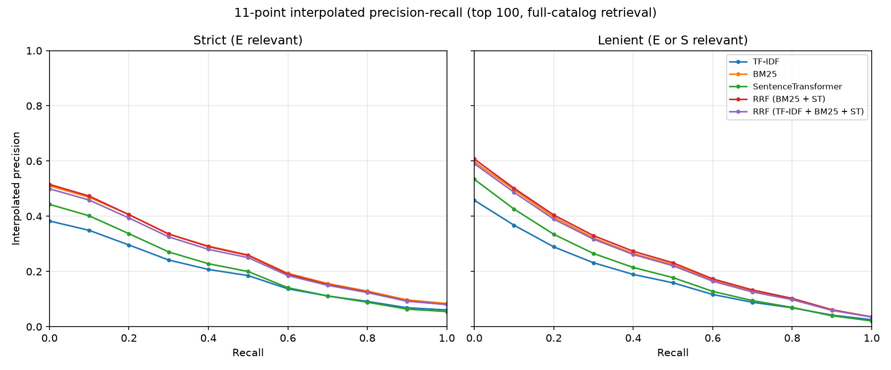

# Product Search using Amazon ESCI

An information-retrieval system for e-commerce product search over the
[Amazon ESCI Shopping Queries Dataset](https://github.com/amazon-science/esci-data)
([paper](https://arxiv.org/abs/2206.06588)). It compares lexical (TF-IDF, BM25),
neural (Sentence Transformer) and hybrid (Reciprocal Rank Fusion) ranking.

## Dataset

Each (query, product) pair is labelled **E**xact, **S**ubstitute, **C**omplement
or **I**rrelevant. This project uses the **US locale, small version** (the
Task 1 ranking subset):

| | |
|---|---|
| Catalog | 482,105 products (every product judged for any US small-version query) |
| Test queries | 8,956 |
| Test judgments | 181,701 |
| Label mix (US small) | E 43.5% · S 35.1% · I 16.9% · C 4.5% |

Products are indexed on `title + brand + color`.

## Pipeline

1. **Preprocessing** (`esci/preprocess.py`): HTML unescape and tag removal,
   lowercasing, punctuation removal, whitespace tokenization, stopword removal,
   Snowball (Porter2) stemming.
2. **Indexing** (`esci/build_index.py`):
   - TF-IDF: sublinear-TF, L2-normalised sparse matrix (scikit-learn)
   - BM25: `bm25s` (k1=1.2, b=0.75)
   - Sentence Transformer: `all-MiniLM-L6-v2` embeddings (384-d, float16)
     over lightly cleaned, unstemmed text
3. **Ranking** (`esci/rankers.py`): TF-IDF cosine, BM25, and dense cosine
   similarity (exact search).
4. **Hybrid** (`esci/fusion.py`): Reciprocal Rank Fusion,
   `score(d) = Σ w_i / (k + rank_i(d))`, over the top 100 of each ranker.
   Standard RRF uses w=1 and k=60. **Weighted RRF** (`esci/tune_rrf.py`) picks
   the BM25 weight and k by grid search on 2,000 *train* queries, selecting by
   nDCG@10. The result is w_BM25=2, w_ST=1, k=5. The test split is never used
   for tuning.
5. **Evaluation** (`esci/evaluate.py`): P@10, Recall@100, MAP@100, nDCG@10,
   11-point interpolated precision-recall curve.
6. **Search interface** (`app.py`): Streamlit app.

## Evaluation setup

- **Full-catalog retrieval:** every method retrieves the top 100 of all 482K
  products for each test query.
- **Binary relevance** (P@10, Recall, MAP, PR curve) is reported two ways:
  *strict* (Exact only) and *lenient* (Exact or Substitute).
- **nDCG@10** uses the official KDD Cup 2022 graded gains:
  E=1.0, S=0.1, C=0.01, I=0.
- ESCI only judges about 20 products per query. Retrieved products without a
  judgment count as non-relevant, so absolute scores are a **lower bound**.
  Comparing methods against each other is still fair.

## Results

All 8,956 US test queries, full-catalog retrieval (482K products), top 100.
Latency is per query on an Apple M1 (8 GB), batched; RRF latency includes
running its component rankers.

**Strict relevance (Exact = relevant)**

| Method                   |   P@10 | Recall@100 |    MAP | nDCG@10 | Latency (ms/query) |
|:-------------------------|-------:|-----------:|-------:|--------:|-------------------:|
| TF-IDF                   | 0.1538 |     0.5096 | 0.1802 |  0.2301 |                1.7 |
| BM25                     | 0.2071 |     0.5669 | 0.2503 |  0.3196 |            **0.5** |
| SentenceTransformer      | 0.1710 |     0.5205 | 0.1988 |  0.2633 |                5.7 |
| RRF (BM25 + ST)          | 0.2079 | **0.6041** | 0.2498 |  0.3195 |                6.2 |
| RRF (TF-IDF + BM25 + ST) | 0.2037 |     0.5890 | 0.2423 |  0.3112 |                7.9 |
| **Weighted RRF (BM25 + ST)** | **0.2155** | 0.6013 | **0.2605** | **0.3313** |            6.2 |

**Lenient relevance (Exact or Substitute = relevant)**

| Method                   |   P@10 | Recall@100 |    MAP | nDCG@10 |
|:-------------------------|-------:|-----------:|-------:|--------:|
| TF-IDF                   | 0.2203 |     0.4291 | 0.1700 |  0.2301 |
| BM25                     | 0.2972 |     0.4851 | 0.2364 |  0.3196 |
| SentenceTransformer      | 0.2521 |     0.4508 | 0.1943 |  0.2633 |
| RRF (BM25 + ST)          | 0.3020 | **0.5207** | 0.2427 |  0.3195 |
| RRF (TF-IDF + BM25 + ST) | 0.2950 |     0.5048 | 0.2331 |  0.3112 |
| **Weighted RRF (BM25 + ST)** | **0.3096** | 0.5175 | **0.2490** | **0.3313** |



Full tables are in [`results/metrics.md`](results/metrics.md) and the CSV files
next to it.

### Findings

- **BM25 is the strongest single ranker** and also the fastest. Compared with
  TF-IDF it gains about 35% on P@10 and 39% on nDCG@10, thanks to
  term-frequency saturation and document-length normalisation.
- **The Sentence Transformer beats TF-IDF but trails BM25.**
  `all-MiniLM-L6-v2` is a general-purpose model that was not fine-tuned on
  product search. Shopping queries are full of model numbers, sizes and brand
  names, where exact token matching matters.
- **Standard RRF (BM25 + ST) adds recall but not precision.** Recall@100
  rises from 0.567 to 0.604 (+6.6%) strict, because the dense model finds
  relevant products that BM25 misses. P@10, MAP and nDCG stay level with BM25:
  equal-weight fusion with a weaker ranker doesn't improve the first few
  positions.
- **Weighted RRF is the best method overall.** Doubling BM25's weight and
  using a small k (so top ranks dominate) keeps nearly all of the recall gain
  (0.601 vs 0.567) and also improves the top of the list over BM25:
  nDCG@10 +3.7%, MAP +4.1%, P@10 +4.1%. The gain is statistically
  significant. Per-query nDCG@10 rises by +0.0117 (95% bootstrap CI
  [+0.0103, +0.0131], paired t-test p ≈ 1e-55), and weighted RRF wins on
  3,393 queries versus 2,668 losses (see
  [`results/significance.txt`](results/significance.txt)). The tuning
  landscape is flat around the optimum
  ([`results/rrf_tuning.csv`](results/rrf_tuning.csv)), so the result isn't
  sensitive to the exact setting.
- **Adding TF-IDF to the fusion hurts.** It is highly correlated with BM25 but
  noisier, so it counts the lexical signal twice and pushes the fused ranking
  toward the worse lexical ranker.
- **Possible next steps:** a dense model fine-tuned on ESCI training pairs, or
  a cross-encoder re-ranker over the fused top 100.

## Usage

```bash
uv sync

# 1. download data (~1.3 GB) into data/
mkdir -p data && cd data
for f in shopping_queries_dataset_examples.parquet shopping_queries_dataset_products.parquet; do
  curl -L -O "https://github.com/amazon-science/esci-data/raw/main/shopping_queries_dataset/$f"
done
cd ..

# 2. build indexes (catalog, TF-IDF, BM25, embeddings)
uv run python -m esci.build_index

# 3. tune weighted RRF on train queries -> results/rrf_best.json
uv run python -m esci.tune_rrf

# 4. evaluate -> results/metrics.md, results/pr_curve.png
uv run python -m esci.evaluate          # add --max-queries 1000 for a quick run
uv run python -m esci.significance      # weighted RRF vs BM25 paired test

# 5. search interface
uv run streamlit run app.py

# tests
uv run pytest
```

## Layout

```
esci/
  preprocess.py   cleaning, tokenization, stemming
  data.py         dataset loading, catalog construction, qrels
  rankers.py      TF-IDF, BM25, Sentence Transformer
  fusion.py       Reciprocal Rank Fusion
  metrics.py      P@k, Recall@k, AP, nDCG, interpolated PR
  build_index.py  builds artifacts/
  evaluate.py     writes results/
  tune_rrf.py     tunes weighted RRF on train queries
  significance.py paired significance test between methods
app.py            Streamlit UI
tests/            unit tests
results/          metrics tables + PR curve
```
